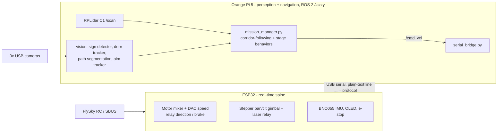

# TEKNOFEST 2026 Unmanned Ground Vehicle (UGV)

A tank-drive robot built for the **TEKNOFEST 2026 UGV competition**: a 3-lane serpentine
obstacle course (fording, aggregate road, side slope, vertical obstacle, traffic cones, sliding
doors, bumped road, 45% incline/decline with 2 s stops) followed by a laser-designation task.
Run 1 is remote-controlled (manual); Run 2 is fully autonomous.

> **Status: work in progress, mostly un-validated on hardware.** Most of this code was written
> and unit-tested without the vehicle in hand. [CLAUDE.md](CLAUDE.md) tracks, per feature,
> exactly what has and has not been confirmed on the real robot - read it before trusting any
> tuning constant in this repo.

## Architecture

Two boards split the work:



- **ESP32** (Arduino, `esp32_firmware/arduino_sketch/esp32_firmware/`): reads SBUS and the
  BNO055, drives the two motors (analog DAC speed + relay direction/brake), the NEMA17 aiming
  gimbal, laser relay, OLED, and the e-stop. Talks to the Pi over a **plain-text serial
  protocol** (not micro-ROS) - the wire format is documented in the `.ino` header comment.
- **Orange Pi 5** (`teknofest_ws_bridge/`, ROS 2 Jazzy): lidar, cameras, vision, and the
  autonomous mission logic, all running as `systemd` services.

## Repository layout

| Path | What it is |
|---|---|
| `esp32_firmware/arduino_sketch/esp32_firmware/` | **Active** ESP32 firmware (flash with Arduino IDE). See `esp32_firmware/PINOUT.md` for pins and the relay map. |
| `esp32_firmware/arduino_sketch/*_test/` | Standalone bring-up sketches (I2C scan, SBUS, gimbal, brake-servo calibration). |
| `esp32_firmware/{src,include,platformio.ini}` | Superseded PlatformIO / micro-ROS project, kept for reference. |
| `teknofest_ws_bridge/` | Orange Pi Python nodes: serial bridge, mission manager, aim tracker, door/path/sign vision, web dashboard, systemd units. |
| `teknofest_ws_bridge/mission_logic.py` | ROS-independent drive logic (corridor following, turn-then-advance, sliding-door state machine, stall detection) - unit tested. |
| `robot_description/` | URDF/xacro, EKF + Nav2 configs (sim and hardware), Gazebo world. Colcon package. |
| `vision_models/` | Training/export code for the sign classifier and path-segmentation CNN. **Weights and datasets are not in git** (see below). |
| `vision_prototyping/` | Laser-target generator and a face-tracking aim demo. |
| `docs/` | Project plan and the Run 2 autonomy plan. |
| `deploy_updates.sh` | Phased deploy of everything to the Orange Pi over SSH. |
| `CLAUDE.md` | Detailed engineering log and operating reference (decisions, history, validation status). |

## Key design decisions

- **Plain serial text protocol instead of micro-ROS** - micro-ROS never completed a session
  with the ESP32 despite a healthy link; a small `rclpy` + `pyserial` bridge worked immediately.
- **Speed is a real analog voltage** (1-3.3 V on the ESP32's DAC pins), not PWM - that is what
  the motor driver expects. Direction and braking are relays, so a direction flip is explicitly
  sequenced: brake, hold zero voltage, flip, then ramp speed back in.
- **No global map.** The course is unknown until race day, so navigation is reactive: lidar
  corridor-following with IMU heading hold, with Nav2 (local costmap + MPPI) scaffolded as an
  alternative. Only one of the two may own `/cmd_vel` at a time.
- **Perception never actuates the vehicle.** The stage-sign detector emits validated stage
  transitions through an `ExecuteStage` action; only `mission_manager.py` decides how to drive.
- **Safety layers fail toward "stopped"**: ESP32 command timeout, stale `/mission/active`,
  stale `/scan`, hardware e-stop, and brake-on-disarm.

## Getting started

### Run the tests (no robot needed)

```bash
cd teknofest_ws_bridge
pip install pytest numpy opencv-python
pytest test_mission_logic.py test_aim_pipeline.py
```

### Flash the ESP32

Open `esp32_firmware/arduino_sketch/esp32_firmware/esp32_firmware.ino` in the Arduino IDE
(ESP32 core + Adafruit BNO055 / PWM Servo Driver / SSD1306 / GFX libraries). Pin assignments are
in `pins.h`; tunables in `config.h`.

### Deploy to the Orange Pi

```bash
bash deploy_updates.sh            # phases 1-5: files, restart services, status check
PI=user@host bash deploy_updates.sh phase1   # override the SSH target
```

Phases 6-8 (robot_description + Nav2 launch / teardown) are explicit-only.

### Hotspot setup

`teknofest_ws_bridge/setup_pi_hotspot.sh` makes the Pi broadcast its own Wi-Fi AP. The password
is a required argument (or `HOTSPOT_PASSWORD`) - none is stored in the repo.

## What is not in this repository

Kept out of git on purpose (see `.gitignore`): trained model weights (`*.pt`, `*.onnx`),
training datasets and captured frames, the PlatformIO dependency cache, scratch files, the
official competition specification PDF, and paper excerpts. The sign-detection stack lives in a
separate package (`ugv-stage-sign-detector`) that this repo only consumes.

## Documentation

- [docs/robot_project_plan.md](docs/robot_project_plan.md) - competition rules distilled into
  engineering requirements, stage-by-stage scoring.
- [docs/run2-autonomy-plan.html](docs/run2-autonomy-plan.html) - the Run 2 autonomy design
  (open in a browser).
- [esp32_firmware/PINOUT.md](esp32_firmware/PINOUT.md) - ESP32 pins and relay channel map.
- [CLAUDE.md](CLAUDE.md) - running engineering log: every decision, bug, and its validation status.
